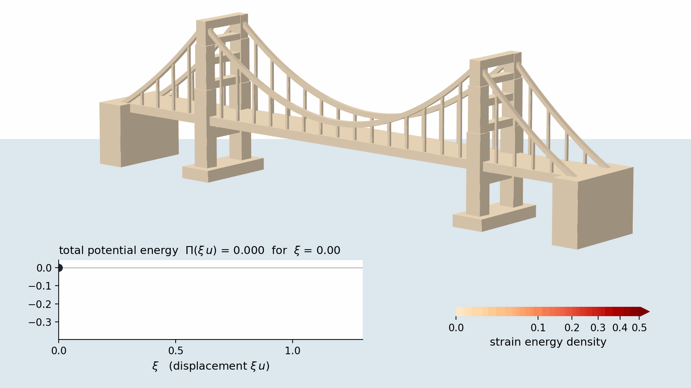
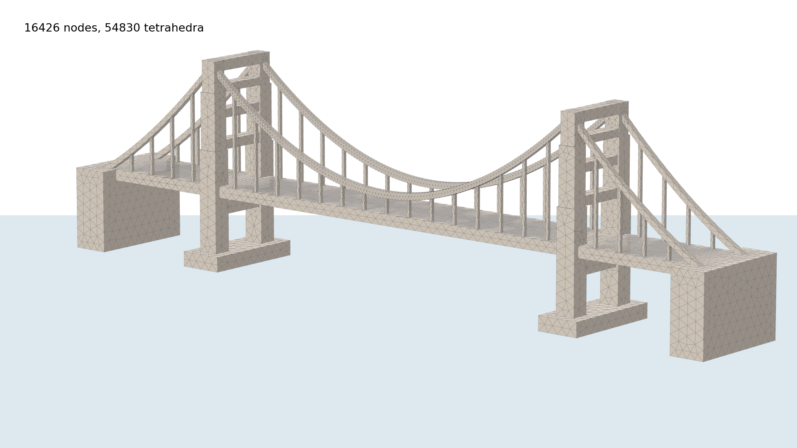
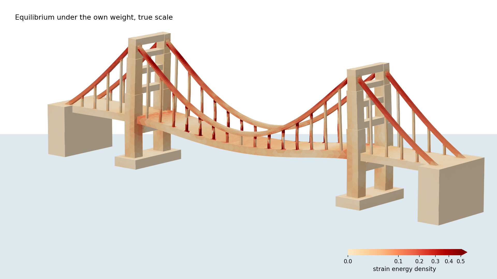

# A suspension bridge and the minimum of the potential energy



A bridge in the style of the Golden Gate Bridge under its own weight, as a problem of linear elasticity in 3D.
It is solved as in chapter 3: write down the total potential energy Π, let `derivative` produce the variational
formulation, solve.

The film shows the principle of minimum potential energy. Let u be the displacement in equilibrium. The bridge
is displaced by ξ·u, from the undeformed state (ξ = 0) to equilibrium (ξ = 1), always under its full weight, and
the graph shows the total potential energy Π(ξ·u) on the way. It falls along the parabola
Π(ξ·u) = Ψ(u)·(ξ² − 2ξ), the parabola of the mass on a spring, and reaches its minimum −Ψ(u) in equilibrium;
beyond it (dotted) it would rise again. The colour is the strain energy density: the cables and the hangers
carry the deck. The displacements are drawn at true scale.

| The mesh | Equilibrium, coloured by the strain energy density |
|---|---|
|  |  |

The numbers: 16 426 nodes, 54 830 tetrahedra and 49 278 unknowns; E = 1000, ν = 0.3 and ρg = 0.3 as in
chapter 3. The deck sinks by 0.51 at midspan (the main span is 12 long), and Π(u) = −Ψ(u) = −0.354.

## Files

| File | |
|---|---|
| [bridge_mesh.py](bridge_mesh.py) | builds the bridge from simple solids with Gmsh and writes the mesh `bridge.xml.gz` |
| [bridge.py](bridge.py) | reads the mesh, solves with FEniCS and writes the two pictures and the film |

## Running

In this folder, with the Docker image of the notes (see the [README](../../README.md) of the repository):

```bash
docker run --rm --user "$(id -u):$(id -g)" -v "$PWD":/home/fenics/shared wolfla/fenics-notebook:2026-10-06 python3 bridge.py
```

It takes about 20 seconds. The mesh is part of the repository, so `bridge_mesh.py` only has to be run after
changing the geometry (same command with `bridge_mesh.py`). Without Docker, `bridge.py` needs legacy FEniCS and
matplotlib; `bridge_mesh.py` also needs Gmsh and meshio (`sudo apt install python3-gmsh python3-meshio` on
Debian or Ubuntu).
